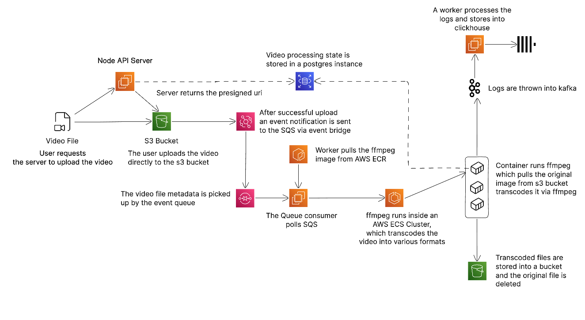
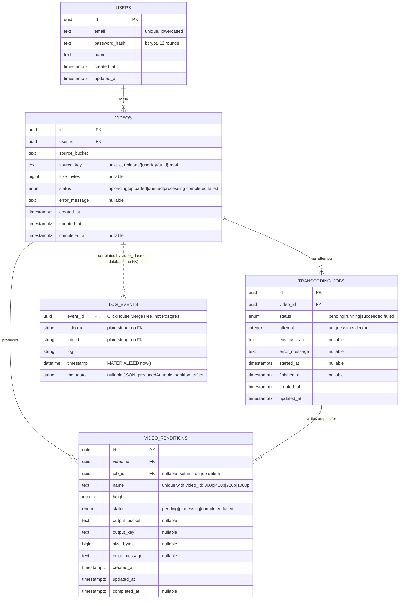
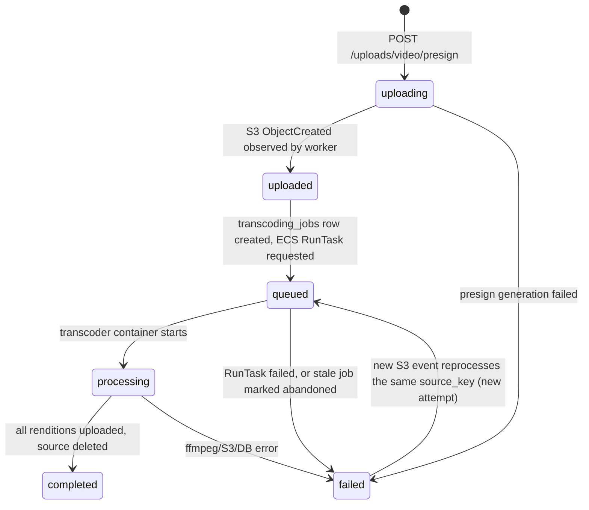
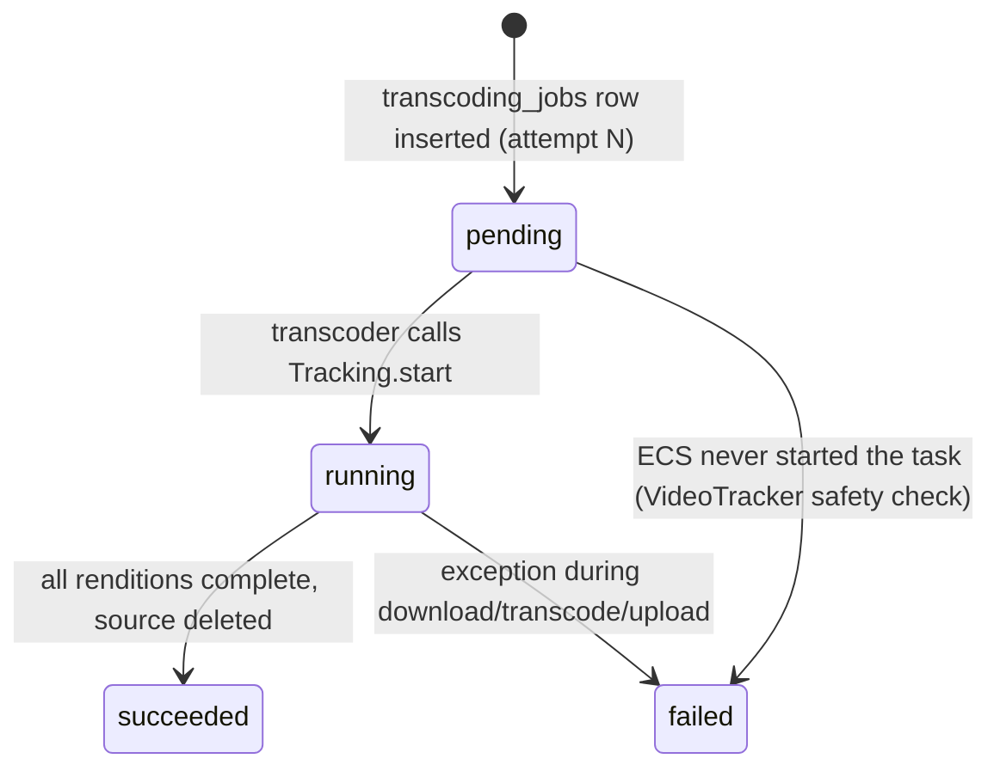
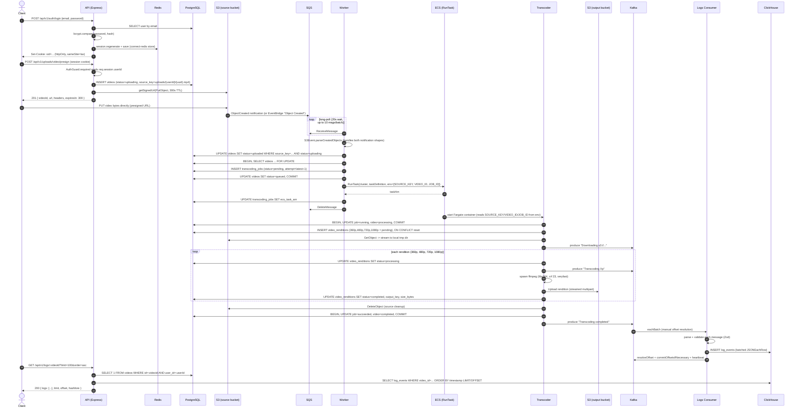

# Video Transcoder

A production-grade, event-driven video transcoding platform. A user requests an upload slot, receives a presigned S3 URL, and uploads the source file directly to object storage — no video bytes ever transit the API. The resulting S3 event fans out through SQS to a worker, which launches an on-demand, isolated ECS Fargate task that transcodes the source into four H.264 renditions (360p–1080p) with FFmpeg, streaming structured progress logs through Kafka into ClickHouse for durable, queryable retrieval.

Built as a pnpm + Turborepo monorepo of four independently deployable Node.js/TypeScript services, backed by PostgreSQL (system of record), Redis (sessions + distributed rate limiting), Kafka (log transport), and ClickHouse (log analytics store).

## Table of contents

- [Why this architecture](#why-this-architecture)
- [Architecture diagram](#architecture-diagram)
- [Services](#services)
- [Data model](#data-model)
- [State machines](#state-machines)
- [Request/processing flow](#requestprocessing-flow)
- [Design details worth knowing](#design-details-worth-knowing)
- [Tech stack](#tech-stack)
- [Getting started](#getting-started)
- [Environment variables](#environment-variables)
- [API overview](#api-overview)
- [API conventions](#api-conventions)
- [Observability](#observability)
- [Security](#security)
- [Deployment notes](#deployment-notes)
- [Repository layout](#repository-layout)
- [Troubleshooting](#troubleshooting)

## Why this architecture

Video transcoding is CPU-heavy, bursty, and long-running — a poor fit for a request/response API process. The system separates concerns along those lines:

- **Upload path bypasses the API entirely.** The API only ever hands out a presigned URL; the client PUTs straight to S3. This keeps the API stateless, cheap to scale, and immune to large-body timeouts/memory pressure.
- **Compute is provisioned per job, not pooled.** Each transcode runs in its own ECS Fargate task, sized by the task definition, started on demand by the worker. There's no always-on fleet of transcoding workers sitting idle, and a stuck/crashed job can't starve other jobs since each gets an isolated container.
- **State transitions are the source of truth, not messages.** SQS/Kafka are transport, not storage — the real status of a video lives in Postgres (`videos`, `transcoding_jobs`, `video_renditions`), updated transactionally by whichever process is doing the work at that moment (worker, then transcoder).
- **Logs are append-only and go to an OLAP store.** Transcoding logs are high-volume, write-heavy, and queried by `video_id` range scans — a poor fit for Postgres row storage. They're decoupled via Kafka and land in ClickHouse's `MergeTree` engine, which is built for exactly this access pattern.

## Architecture diagram



> `architecture.png` lives in the repo root but is listed in `.gitignore` and is **not committed** — it renders when you view this README locally (or in an editor with the file present) but will show as a broken image on GitHub.com, since the file was deliberately kept out of version control.

At a high level:

1. **API** issues a presigned S3 `PUT` URL and records a `videos` row (`status = uploading`).
2. The **client uploads directly to S3** using that URL.
3. S3 emits an `ObjectCreated` event onto an **SQS** queue (via S3 event notifications or EventBridge — the worker parses both shapes).
4. **Worker** long-polls SQS, transactionally creates a `transcoding_jobs` row, and calls ECS `RunTask` to launch the **transcoder** as a one-shot **Fargate** container, passing `SOURCE_KEY` / `VIDEO_ID` / `JOB_ID` as container environment overrides.
5. **Transcoder** downloads the source from S3, produces 360p/480p/720p/1080p renditions with FFmpeg, uploads each to the output bucket, updates job/video/rendition rows directly in Postgres, deletes the source object on success, and streams progress lines to a **Kafka** topic throughout.
6. **Logs-consumer** batches Kafka messages per-partition into **ClickHouse** (`log_events`), committing offsets only after a successful batch insert.
7. The **API** reads from ClickHouse (after verifying video ownership in Postgres) to serve paginated per-video logs to the client.

## Services

| App                  | Package                            | Runtime shape                 | Role                                                                                                  |
| --------------------- | ----------------------------------- | ------------------------------ | ------------------------------------------------------------------------------------------------------ |
| `apps/api`             | `@video-transcoder/api`             | Long-running Express server    | Public REST API: session auth, presigned uploads, log retrieval, OpenAPI/Swagger docs                  |
| `apps/worker`          | `@video-transcoder/worker`          | Long-running Express server + background poller | Polls SQS for S3 upload events, owns job-creation transactions, launches ECS Fargate transcode tasks |
| `apps/transcoder`      | `@video-transcoder/transcoder`      | Short-lived, one-shot process (runs **inside** ECS Fargate) | Downloads source, runs FFmpeg per rendition, uploads outputs, updates Postgres, publishes Kafka logs, exits |
| `apps/logs-consumer`   | `@video-transcoder/logs-consumer`   | Long-running Express server + background consumer | Batches Kafka log messages into ClickHouse                                                             |

Every long-running service exposes `GET /health` with dependency probes, uses Pino for structured JSON logging, generates/propagates an `X-Request-Id`, and validates its environment eagerly at boot with Zod via `@t3-oss/env-core` — a missing or malformed env var fails fast with a readable list of violations instead of surfacing as a runtime `undefined`.

The `api` and `worker` apps also share the exact same `ApiError` / `ApiResponse` / `ErrorHandler` / `RequestId` primitives (duplicated per-service rather than extracted into a shared package, by design, so each service can evolve its error shape independently).

## Data model

Postgres is the system of record for users, videos, transcoding jobs, and per-rendition output state. The schema (Drizzle ORM, see `apps/api/src/db/schema.ts`) is defined **identically** in `api`, `worker`, and `transcoder` — each service owns its own Drizzle client against the same physical database, rather than one service exposing a data-access API to the others.



### Indexes and constraints that matter

- `videos_user_id_idx`, `videos_status_idx` — the two filters the API/worker actually query by.
- `transcoding_jobs_video_id_attempt_unique` on `(video_id, attempt)` — makes "one row per retry attempt" a database-enforced invariant rather than an application convention.
- `video_renditions_video_id_name_unique` on `(video_id, name)` — lets the transcoder `INSERT ... ON CONFLICT DO UPDATE` to reset a rendition row to `pending` at the start of each new attempt, rather than accumulating duplicate rendition rows across retries.
- `videos.source_key` is `unique` — the S3 object key doubles as the natural join key the worker uses to find the `videos` row for an incoming S3 event, since the event only carries bucket+key, not the video's UUID.
- All `*_id` foreign keys cascade or null-out on delete (`videos → users` cascades; `video_renditions.job_id → transcoding_jobs` sets null) so deleting a user or retrying a job never leaves orphaned rows in an inconsistent state.

### Why ClickHouse is a second, unlinked store

`log_events` has no foreign key into Postgres — `video_id`/`job_id` are plain strings. This is deliberate: cross-database referential integrity isn't enforceable anyway, log volume is orders of magnitude higher than row volume in Postgres, and `MergeTree` partitioned by `toYYYYMM(timestamp)` is tuned for append-heavy, range-scan-heavy workloads that would otherwise bloat Postgres tables and indexes. Ownership is still enforced at the API layer — `LogsService.getVideoLogs` checks `videoBelongsToUser` against Postgres *before* ever querying ClickHouse, so a user can't read another user's logs just because ClickHouse itself has no concept of ownership.

## State machines





## Request/processing flow

End-to-end sequence from login through upload to log retrieval:



## Design details worth knowing

These are the non-obvious decisions baked into the code — the kind of thing you'd otherwise have to read every file to discover.

**Idempotent, retry-safe job creation.** `VideoTracker.start` (worker) runs inside a `SELECT ... FOR UPDATE` transaction: if the video is already `processing`/`completed` it's a no-op (duplicate SQS delivery, since SQS offers at-least-once delivery); if it's `queued` with a task already started, it's also a no-op; if it's `queued` but the ECS task never actually got an ARN recorded (a crash between `RunTask` and the ARN write), the stale job is marked `failed` and a fresh attempt is created. This means redelivered or duplicate S3 events can't double-launch a transcode.

**Every retry is a new row, not a mutation.** `transcoding_jobs` is append-only per video (`attempt` increments), so job history — including every failure reason — survives retries instead of being overwritten. `video_renditions` is the one place that *does* reset in place (`ON CONFLICT DO UPDATE`), since a rendition's current state only matters for the active attempt.

**SQS messages are only deleted after full processing.** If `TranscoderTask.run` throws (e.g. ECS capacity error), the message is never deleted and is left on the queue to be retried by SQS's own redelivery — the worker doesn't implement its own retry/backoff for this path, it leans on the queue.

**Two S3 event shapes, one parser.** `S3Event.parseCreatedObjects` handles both the classic S3 bucket-notification `Records[]` format and the newer EventBridge `"detail-type": "Object Created"` format, so the SQS source can be wired either way without code changes.

**The transcoder is a CLI, not a server.** `apps/transcoder/src/index.ts` is a `main()` that connects, runs exactly one video end-to-end, and calls `process.exit(0|1)` — it has no HTTP server, no health endpoint, and no retry loop of its own. Fargate's task-level exit code is the only signal; failure handling and retries live entirely in the worker/SQS layer above it.

**Output key mirrors input key, minus the `uploads/` prefix.** `Transcoder.outputPrefix` strips a leading `uploads/` segment and the file extension, so `uploads/{userId}/{uuid}.mp4` becomes output objects at `{userId}/{uuid}/{rendition}.mp4` in the transformed bucket — renditions for one video are grouped under one prefix.

**Source cleanup only happens on full success.** The original upload is deleted from S3 only after every rendition has uploaded successfully — a partial failure leaves the source intact so a retry attempt can re-download it.

**Kafka log production is best-effort and never blocks transcoding.** `processLogs` always `console.log`s first; the Kafka `send` is wrapped in try/catch and swallows its own errors. If the Kafka broker is down, FFmpeg still runs and the DB is still updated — only the ClickHouse-visible log trail is lost.

**Logs-consumer commits offsets only after ClickHouse accepts the batch.** `eachBatchAutoResolve: false` plus manual `resolveOffset`/`commitOffsetsIfNecessary` means a ClickHouse insert failure throws before offsets are committed, so KafkaJS will redeliver the same batch rather than silently dropping log lines.

**Rate limiting is per-route, backed by Redis, and fails closed.** Each sensitive route (`/auth/*`, `/uploads/video/presign`, `/logs/:videoId`) gets its own `RateLimiterRedis` instance with its own key prefix/points/duration, in addition to a global limiter applied to every `/api/v1` request. If Redis itself is unreachable, the limiter middleware treats that as a 500 (`ApiError.internal`), not a silent bypass — rate limiting fails safe rather than fails open.

**Error responses distinguish operational from programmer errors.** `ApiError.internal` is the only constructor that sets `isOperational: false`. In production, non-operational error messages and `details` are replaced with a generic "Internal server error" before being sent to the client (stack traces are always Postgres/Kafka-stripped in prod); operational errors (4xx, validation, conflicts) are shown verbatim since they're meant to be actionable by the caller.

## Tech stack

| Layer                      | Choice                                                                   |
| --------------------------- | -------------------------------------------------------------------------- |
| Language / runtime          | TypeScript (ESM throughout), Node.js ≥ 20                                 |
| Monorepo tooling            | pnpm workspaces, Turborepo (task graph + caching)                         |
| Build                       | `tsup` (per-app bundling), `tsx watch` for dev                             |
| HTTP framework              | Express 4                                                                   |
| ORM / migrations            | Drizzle ORM + drizzle-kit (schema shared across `api`/`worker`/`transcoder`) |
| Primary datastore           | PostgreSQL 17                                                               |
| Sessions                    | `express-session` + `connect-redis` (Redis-backed, rolling TTL)             |
| Rate limiting               | `rate-limiter-flexible` with a Redis store, per-route + global limiters     |
| Log transport               | Kafka (`kafkajs`), optional TLS + SASL/PLAIN                                |
| Log analytics store         | ClickHouse, `MergeTree` engine partitioned by month                        |
| Object storage              | AWS S3 (presigned uploads in, FFmpeg renditions out)                       |
| Event delivery              | AWS SQS, consuming S3 `ObjectCreated` notifications or EventBridge events  |
| Compute for transcoding     | AWS ECS Fargate — one task per transcode job, launched on demand            |
| Media processing            | FFmpeg, spawned as a child process (`libx264` + `aac`, H.264/MP4 output)    |
| Validation                  | Zod everywhere (request bodies/params/query, Kafka message payloads, env)   |
| Env config                  | `@t3-oss/env-core`, validated eagerly at process start, fails fast          |
| Security middleware         | Helmet, bcrypt (12 rounds), httpOnly/sameSite/secure-in-prod session cookies |
| Logging                     | Pino (structured JSON), `pino-http` request logging, per-request ID        |
| API docs                    | Hand-written OpenAPI 3 YAML, served via Swagger UI at `/docs`               |

## Getting started

Prerequisites: Node.js ≥ 20, pnpm, Docker (for local Postgres/Redis), and — for the full pipeline — AWS credentials with access to an S3 bucket pair, an SQS queue wired to that bucket's `ObjectCreated` events, an ECS cluster + task definition for the transcoder image, plus a reachable Kafka broker and ClickHouse instance.

```bash
pnpm install
docker compose up -d        # Postgres 17 + Redis 7, with healthchecks
pnpm dev                    # runs `dev` in every app, fanned out via turbo
```

Each app needs its own `.env` — copy the `.env.example` in `apps/api`, `apps/worker`, `apps/transcoder`, and `apps/logs-consumer`, and fill in the values from the [Environment variables](#environment-variables) section. Every service validates its env with Zod at startup and throws a readable error listing every missing/invalid key, so a misconfigured deploy fails immediately instead of at first use.

Before running the worker/transcoder path end-to-end, you also need:

- an S3 bucket notification (or EventBridge rule) that pushes `s3:ObjectCreated:*` events for the source bucket onto the SQS queue referenced by `SQS_URL`;
- an ECS task definition for the transcoder image (see `apps/transcoder/Dockerfile`) registered in the cluster referenced by `ECS_CLUSTER`/`ECS_TASK_DEFINITION`, with network config matching `ECS_SUBNETS`/`ECS_SECURITY_GROUPS`.

Apply the Postgres schema with Drizzle before starting `api`/`worker`/`transcoder`:

```bash
pnpm db:generate   # generate SQL migrations from the schema (already checked in under apps/api/drizzle)
pnpm db:migrate    # apply migrations
```

### Common commands

Run from the repo root, fanned out to all apps via Turborepo:

| Script              | Purpose                      |
| -------------------- | ----------------------------- |
| `pnpm dev`           | Start all apps in dev mode (`tsx watch`) |
| `pnpm build`         | Build all apps (`tsup`)        |
| `pnpm start`         | Start all apps from built output (production) |
| `pnpm typecheck`     | Type-check all apps (`tsc --noEmit`) |
| `pnpm db:generate`   | Generate Drizzle migrations from schema changes |
| `pnpm db:migrate`    | Apply Drizzle migrations       |
| `pnpm db:push`       | Push schema directly without a migration file (dev only) |
| `pnpm db:studio`     | Open Drizzle Studio against the configured `DATABASE_URL` |

Scope any command to a single app with turbo's filter flag:

```bash
pnpm turbo run dev --filter=@video-transcoder/api
```

## Environment variables

### `apps/api`

| Variable | Required | Default | Description |
| --- | --- | --- | --- |
| `NODE_ENV` | no | `development` | `development` \| `test` \| `production` — gates cookie `secure` flag and error detail exposure |
| `PORT` | no | `3000` | HTTP listen port |
| `CORS_ORIGIN` | no | `*` | Comma-separated allowed origins; `credentials: true` is always set |
| `DATABASE_URL` | yes | — | Postgres connection string |
| `REDIS_URL` | yes | — | Redis connection string — backs sessions and rate limiting |
| `SESSION_SECRET` | yes (≥16 chars) | — | `express-session` signing secret |
| `SESSION_TTL` | no | `86400` | Session TTL in seconds (rolling — refreshed on each request) |
| `SESSION_COOKIE_NAME` | no | `sid` | Session cookie name |
| `RATE_LIMIT_POINTS` / `RATE_LIMIT_DURATION` | no | `100` / `60` | Global per-IP rate limit (points per duration, seconds) |
| `AWS_ACCESS_KEY` / `AWS_SECRET_KEY` / `AWS_REGION` / `AWS_S3_BUCKET` | yes | — | S3 credentials/bucket for generating presigned upload URLs |
| `CLICKHOUSE_URL` | yes (valid URL) | — | ClickHouse HTTP endpoint for log reads |
| `CLICKHOUSE_USERNAME` | no | `default` | ClickHouse user |
| `CLICKHOUSE_PASSWORD` | yes | — | ClickHouse password |

### `apps/worker`

| Variable | Required | Default | Description |
| --- | --- | --- | --- |
| `NODE_ENV` / `PORT` | no | `development` / `4000` | |
| `DATABASE_URL` | yes | — | Postgres connection string (same database as `api`) |
| `AWS_ACCESS_KEY` / `AWS_SECRET_KEY` / `AWS_REGION` / `AWS_S3_BUCKET` | yes | — | Credentials and the **source** bucket the worker expects S3 events from (events from any other bucket are logged and ignored) |
| `SQS_URL` | yes (valid URL) | — | Queue receiving S3 `ObjectCreated` notifications |
| `ECS_CLUSTER` / `ECS_TASK_DEFINITION` | yes | — | Target cluster and task definition for the transcoder |
| `ECS_CONTAINER_NAME` | no | `transcoder` | Container name inside the task definition to apply env overrides to |
| `ECS_SUBNETS` / `ECS_SECURITY_GROUPS` | yes (comma-separated) | — | Fargate `awsvpc` networking |
| `ECS_ASSIGN_PUBLIC_IP` | no | `ENABLED` | `ENABLED` \| `DISABLED` |

### `apps/transcoder`

Runs as a one-shot ECS task; most of these are injected by the worker's `RunTask` container override rather than set in a static `.env`.

| Variable | Required | Description |
| --- | --- | --- |
| `DATABASE_URL` | yes | Postgres connection string (same database as `api`/`worker`) |
| `AWS_S3_BUCKET` / `AWS_S3_TRANSFORMED_BUCKET` | yes | Source bucket to download from, output bucket to upload renditions to |
| `VIDEO_ID` / `JOB_ID` / `SOURCE_KEY` | yes | Injected per-task by the worker's ECS `RunTask` container override — the process exits immediately if any are missing |
| `KAFKA_BROKER` | yes | Kafka bootstrap broker |
| `KAFKA_SSL` / `KAFKA_SASL` | no | Enable TLS (reads `ca.pem` from the working directory) / SASL-PLAIN auth |
| `KAFKA_USERNAME` / `KAFKA_PASSWORD` | if `KAFKA_SASL` | SASL credentials |
| `KAFKA_LOGS_TOPIC` | yes | Topic progress logs are produced to |

### `apps/logs-consumer`

| Variable | Required | Description |
| --- | --- | --- |
| `KAFKA_BROKER` / `KAFKA_SSL` / `KAFKA_SASL` / `KAFKA_USERNAME` / `KAFKA_PASSWORD` | see above | Same Kafka cluster as the transcoder |
| `KAFKA_LOGS_TOPIC` | yes | Must match the transcoder's topic |
| `KAFKA_GROUP_ID` | yes | Consumer group id |
| `CLICKHOUSE_URL` / `CLICKHOUSE_USERNAME` / `CLICKHOUSE_PASSWORD` | yes | Sink for batched log rows |

See each app's `.env.example` for the authoritative, exhaustive list — the tables above cover the variables that affect behavior, not every low-level knob.

## API overview

All routes are mounted under `/api/v1`. Full OpenAPI 3 documentation (hand-written, served from `apps/api/openapi.yaml`) is available via Swagger UI at `/docs`.

| Method | Path                      | Auth     | Rate limit        | Description                              |
| ------ | -------------------------- | -------- | ------------------ | ------------------------------------------ |
| POST   | `/auth/register`           | —        | 10 / 60s           | Create an account (email, password ≥8 chars, name) |
| POST   | `/auth/login`                | —        | 10 / 60s           | Authenticate; regenerates the session, issues a cookie |
| POST   | `/auth/logout`               | Session  | global only         | Destroys the session, clears the cookie    |
| GET    | `/auth/me`                   | Session  | global only         | Current user profile (no password hash)    |
| POST   | `/uploads/video/presign`     | Session  | 20 / 60s           | Creates a `videos` row and a presigned S3 `PUT` URL (300s TTL) |
| GET    | `/logs/:videoId`             | Session  | 60 / 60s           | Paginated transcoding logs from ClickHouse, scoped to the caller's own video |
| GET    | `/health`                    | —        | —                   | Liveness + Postgres/Redis dependency probe |

Every `/api/v1` route is additionally covered by a global limiter (`RATE_LIMIT_POINTS` per `RATE_LIMIT_DURATION`, default 100/60s per IP) layered underneath the per-route limiters above.

### `GET /logs/:videoId` query parameters

| Param | Type | Default | Notes |
| --- | --- | --- | --- |
| `jobId` | UUID | — | Optional; scopes results to one transcoding attempt |
| `limit` | integer, 1–500 | `100` | |
| `offset` | integer ≥ 0 | `0` | |
| `order` | `asc` \| `desc` | `asc` | Sorted by ClickHouse `timestamp`, tie-broken by the producer's own `producedAt` from message metadata |

## API conventions

**Response envelope.** Every response — success or error — is JSON shaped as:

```json
{
  "success": true,
  "message": "OK",
  "data": { ... },
  "requestId": "a53e...  "
}
```

Errors use the same envelope with `success: false`, `data: null`, and (outside production, or for operational errors) an optional `details` field and — outside production only — a `stack` field.

**Request correlation.** Every request gets an `X-Request-Id` (reusing the client-supplied header if present, otherwise a generated UUID), echoed back in the response header and in every log line and error body for that request — so a single `requestId` can be grepped across API logs, worker logs, and (via the `jobId`/`videoId` it's associated with) transcoder/log-consumer output.

**Auth model.** Cookie-based sessions (`express-session`, Redis-backed via `connect-redis`), not JWTs or API keys. Cookies are `httpOnly`, `sameSite: lax`, `secure` in production, with a rolling TTL that refreshes on each request. Login calls `session.regenerate()` before setting `userId`, which rotates the session ID on privilege change and mitigates session fixation.

**Validation.** All route params/query/bodies are validated with Zod via a shared `Validate` middleware before reaching a controller — invalid input never reaches business logic.

## Observability

- **Structured logs.** Every long-running service uses Pino; HTTP services additionally use `pino-http` to log one structured line per request (level escalates to `warn` on 4xx and `error` on 5xx or thrown errors).
- **Health checks.** `GET /health` on `api`/`worker`/`logs-consumer` actively pings their real dependencies (Postgres always; Redis on `api`) and reports per-dependency status and latency, not just "process is up." `logs-consumer` separately exposes `LogsConsumer.isRunning` for its Kafka consumer loop.
- **Correlation across async boundaries.** `requestId` ties together API request/response/log lines; `videoId`/`jobId` tie together worker → transcoder → Kafka → ClickHouse → API log-read, so a single video's full lifecycle is traceable even though it crosses four services and three different datastores.
- **Graceful shutdown.** `worker` (and the other long-running services, by the same pattern) listen for `SIGTERM`/`SIGINT`, stop accepting new SQS messages, let in-flight work finish, close the HTTP server and DB pool, and force-exit after a 10s timeout if shutdown hangs — so a rolling deploy doesn't drop in-flight jobs mid-processing.

## Security

- Passwords hashed with bcrypt at 12 rounds; login failure uses a constant dummy hash comparison when the user doesn't exist, so the response timing doesn't leak whether an email is registered.
- `helmet()` on every HTTP service; `x-powered-by` disabled.
- Sessions are `httpOnly` + `sameSite=lax`, `secure` in production, stored server-side in Redis (not a signed-client-readable JWT) so they can be revoked by deleting the Redis key.
- Rate limiting is Redis-backed (works correctly across multiple API instances, unlike an in-memory limiter) and **fails closed**: if Redis is unreachable, requests are rejected with a 500 rather than silently bypassing the limit.
- Log access is ownership-checked against Postgres before any ClickHouse query runs — `videoId` alone is not sufficient to read another user's logs.
- `CORS` requires explicit origins (comma-separated) in any deployment that isn't wide open (`*`), and always sends `credentials: true`, so cookie-based auth only works from origins you've allowlisted.
- The transcoder container (see `apps/transcoder/Dockerfile`) runs as the non-root `ubuntu` user in its final stage, not root.

## Deployment notes

- **`api`, `worker`, `logs-consumer`** are conventional long-running Node HTTP services — deploy however you'd deploy any Express app (container, VM, ECS service, etc.), each needs its own env per the table above.
- **`transcoder`** is *not* a long-running service — it's built as a Docker image (multi-stage: `pnpm build` in a `node:22-slim` builder, FFmpeg + the built `dist/` copied into an `ubuntu:24.04` runtime) and registered as an ECS **task definition**, never run as a standing ECS **service**. The worker calls `RunTask` once per transcoding attempt; ECS tears the container down when the process exits.
- The transcoder image's `.env` and `ca.pem` are copied into the image at build time (see the `Dockerfile`) rather than injected at runtime — review what's baked into that image before pushing it anywhere, since `VIDEO_ID`/`JOB_ID`/`SOURCE_KEY` are the only values actually overridden per-task by the worker.
- All four services' `DATABASE_URL` should point at the same Postgres instance — the schema is physically shared, not replicated or synced between services.
- `logs-consumer` and `transcoder` must agree on `KAFKA_LOGS_TOPIC` (and ideally run against the same broker/TLS/SASL config) or logs silently never arrive in ClickHouse.

## Repository layout

```
apps/
  api/            Express + TypeScript API — auth, presigned uploads, log retrieval, Swagger docs
    src/db/schema.ts        Drizzle schema (users, videos, transcoding_jobs, video_renditions)
    src/modules/            auth, uploads, logs, health — each with routes/controller/service/repository
    src/middlewares/        auth guard, rate limiter, error handler, request id, validation
    openapi.yaml             Hand-written OpenAPI 3 spec served at /docs
  worker/         SQS consumer that launches ECS Fargate transcode tasks
    src/lib/queue-consumer.ts   SQS long-poll loop, dedupe/idempotency guard
    src/lib/transcoder-task.ts  ECS RunTask invocation
    src/lib/video-tracker.ts    Transactional job/video state transitions
  transcoder/     One-shot ECS task: ffmpeg renditions, S3 -> S3, Kafka log producer
    src/transcoder.ts        Orchestrates download -> per-rendition ffmpeg -> upload -> cleanup
    src/lib/ffmpeg.ts         FFmpeg invocation + rendition ladder (360p/480p/720p/1080p)
    src/lib/tracking.ts       Postgres status updates for the active job/video/renditions
    Dockerfile                Multi-stage build; ships FFmpeg + the compiled worker in one image
  logs-consumer/  Kafka consumer that batches log events into ClickHouse
    src/lib/logs-consumer.ts   Manual-offset batch consumer
    src/logs/log-events.sql    ClickHouse DDL (MergeTree, monthly partitions)
docker-compose.yml  Local Postgres 17 + Redis 7 with healthchecks
turbo.json          Turborepo task graph (dev/build/start/typecheck/db:*)
pnpm-workspace.yaml
```

## Troubleshooting

| Symptom | Likely cause | Where to look |
| --- | --- | --- |
| Video stuck in `uploading` | Presign succeeded but the client never actually completed the S3 `PUT`, or the S3 event notification isn't wired to the SQS queue | Check S3 bucket event notification config; `videos.source_key` will exist but no SQS message ever arrives |
| Video stuck in `queued` with no `ecs_task_arn` | Worker crashed between `RunTask` and recording the ARN | `VideoTracker.start` self-heals on the *next* S3 event for that key — it won't retry itself without one |
| Video `failed` with no rendition progress | FFmpeg isn't installed/reachable in the transcoder's runtime, or the source file is unreadable | Check `transcoding_jobs.error_message` / `videos.error_message`; transcoder logs the ffmpeg stderr tail (last 4000 bytes) on non-zero exit |
| Logs never show up via `GET /logs/:videoId` | Kafka producer/consumer topic mismatch, broker unreachable, or `KAFKA_SSL`/`KAFKA_SASL` misconfigured between `transcoder` and `logs-consumer` | `processLogs` swallows Kafka send errors — check transcoder stdout (it always `console.log`s first) vs. `logs-consumer` connection logs |
| `429 Too many requests` unexpectedly | Hit a per-route limiter (e.g. `/auth/*` at 10/60s) or the global limiter | Response includes `Retry-After` and `X-RateLimit-Remaining` headers; check which `keyPrefix` is involved |
| `500` on every request suddenly | Redis unreachable — the rate limiter fails closed rather than open | Check Redis connectivity; this is deliberate, not a bug |
